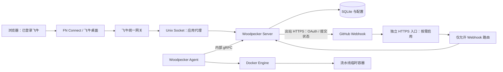

# Woodpecker 飞牛应用部署技术方案

文档状态：讨论稿 v0.2。创建日期：2026-11-03；本次复核：2026-11-04。本文依据官方文档和目标 NAS 的只读检查编写；尚未安装 Woodpecker，也未修改 NAS 上的应用、网络或权限。原文件名保留创建日期，避免讨论链接失效。

已确认决定：用户确认应用访问路径为 `/app/woodpecker`。下文以此为固定前缀；实际 FN Connect 主机名、回调入口设施和其他待讨论项不由该路径决定。

## 1. 结论与目标

建议将 Woodpecker 包装成可手动安装的 `.fpk`，由飞牛应用中心管理内部 Docker Compose 项目。首版包含 Woodpecker Server、一个 Docker Agent 和网关适配代理。管理页面优先接入飞牛统一网关，经 FN Connect 远程访问；GitHub Webhook 按需使用独立 HTTPS 回调入口。

这条路线满足“像飞牛应用一样安装、启停、升级，并通过 FN Connect 查看和操作 CI”的目标。完整 CI 的成立还取决于 GitHub 登录、Webhook 投递、构建执行和提交状态回传，不能仅凭页面能打开就宣布部署成功。

推荐首版范围：

- 面向这台 x86 NAS，先支持 GitHub 和个人自有仓库。
- 手动安装 FPK；不把上架官方应用商店作为交付前提。
- Server 使用 SQLite，Agent 与 Server 同机，构建并发为 1。
- 保留 Woodpecker 自身的 GitHub OAuth 登录和仓库授权。
- 安装向导收集必要配置，提供日志、备份、升级及回滚说明。
- 用真实仓库的一次 push，验证 Webhook → 构建 → 状态回传完整链路。

首版不包含多租户、任意公众仓库执行、Kubernetes、容器镜像仓库、构建产物分发平台和高可用数据库。后续如需构建大型镜像，可把 Agent 迁到独立机器，而保留 NAS 上的管理应用。

## 2. 已确认的环境与证据边界

### 2.1 目标设备实测

以下为 2026-11-03 通过 SSH 读取的结果，是当时的快照：

| 项目 | 实测结果 | 对方案的影响 |
| --- | --- | --- |
| SSH | `nice007@192.168.2.13`，默认 22 端口 | 后续运维入口；密码不写入仓库 |
| fnOS | `/usr/trim/etc/version` 为 `1.2.0800` | 已安装应用使用统一网关，具备参考实现 |
| 系统与架构 | Debian 12，Linux `6.18.18.c1126-trim`，x86_64 | 首版 FPK 标记 `platform=x86` |
| CPU | Intel Core i7-8565U，4 核 8 线程 | 可运行轻中型 CI，避免默认吃满 CPU |
| 内存 | 总计 7690 MiB，available 约 3652 MiB | 先限制并发，再依据真实流水线测量 |
| Swap | 总计 4095 MiB，已使用约 2709 MiB | 已有内存压力迹象，不预设多任务并发 |
| Docker | `29.1.2` | 已具备容器运行环境 |
| Compose | `v5.0.0` | 核对飞牛实际调用方式后使用相应语法 |
| fnpack | `1.2.4`，已核对 create/build 帮助 | 可在 NAS 上打包，不必先安装本机工具 |
| appcenter-cli | `/usr/local/bin/appcenter-cli`，root 专有执行权限 | 普通 SSH 用户不能直接安装；优先使用应用中心手动安装 |
| Docker 权限 | SSH 用户属于 docker 组；socket 为 `root:docker`、`0660` | SSH 可检查 Docker；不代表新建应用用户自动拥有同等权限 |
| Docker 数据目录 | `/vol2/docker` | 镜像和构建缓存实际占用第二存储卷 |
| 存储余量 | 系统分区约 22 GiB；`/vol1` 约 1.3 TiB；`/vol2` 约 323 GiB | 建议应用安装到卷 2，避免将 CI 数据放系统分区 |
| 已有负载 | 多个业务应用、数据库和代理容器正在运行 | 不更改现有容器、端口、代理或数据库 |
| Docker 占用 | 镜像约 34.73 GB，Build Cache 约 29.11 GB | 后续只清理本应用产生的资源，不执行全局 prune |
| 统一网关参考 | 已有应用声明 `gatewayPrefix` 和 `gatewaySocket` | 支持选用相同接入模型；不等于 Woodpecker 已适配成功 |
| 网络 | NAS 到 GitHub 返回 HTTP 200；Docker Hub registry 返回预期的 401 认证挑战 | 仅证明当时可建立 HTTP 连接，尚未验证镜像拉取和仓库克隆 |
| Woodpecker | 未发现名称匹配的已有容器 | 仍需安装前确认包名、项目名和数据目录没有冲突 |

只读检查没有执行提权、镜像拉取、安装、容器启停、清理或配置修改。`sudo -n` 提示需要密码，尚未核对管理员权限下的 `appcenter-cli --help`。

### 2.2 官方能力、推导与待验证项

已由官方文档确认：

- FPK 支持 `docker-project`，Compose 项目由应用中心管理。
- 统一网关支持 HTTP、WebSocket，以及 `${TRIM_APPDEST}` 下的 Unix Socket。
- 网关转发前检查 NAS 用户会话，并提供用户身份 Header；业务授权仍由应用负责。
- FN Connect 支持第三方应用和 Docker 访问，但公开资料没有给出匿名 Webhook 的完整接入契约。
- FN Connect 的权益带宽针对其远程连接和中继链路；中继时才统计对应流量，不会自动加速 NAS 拉代码、依赖或镜像。

必须实测的部分：

- Woodpecker 在 `/app/woodpecker` 前缀下的静态资源、登录回跳、日志流和页面导航。
- 实际 FN Connect 域名、访问码设置、浏览器登录会话和应用打开方式。
- 无 NAS 登录态的外部 POST 是否能到达目标入口，是否保留 hook token 查询参数、事件 Header 与原始请求体。
- 飞牛传给网关的 Host、协议 Header，以及 Unix Socket 的可访问权限。
- 应用包用户的 Docker 状态检查权限、容器数据目录 UID/GID、卸载保留语义。

本文不假定存在 `skipAuth`、`publicPaths` 或 `auth=false` 等飞牛配置，也不修改系统鉴权来让 GitHub 回调通过。

## 3. 推荐架构

### 3.1 两条访问链路



FPK 提供三个运行模块：

1. **Server**：Web 页面、GitHub OAuth、Webhook 验证、任务调度和数据库。
2. **Agent**：只连接 Compose 内部 Server 的 gRPC 地址，向 Docker Engine 申请运行流水线容器。
3. **网关代理**：将飞牛 Unix Socket 转发到 Server；按需提供仅供本机隧道访问的 Webhook 监听端口。该模块只处理接入协议，不替代 Woodpecker 的认证与业务逻辑。

同一个模块承担两个明确接口：面向飞牛的页面访问，以及面向 GitHub 的受限回调。配置生成、生命周期和状态检查分别集中处理，避免将环境变量、目录路径及代理规则散落在多个脚本中。

### 3.2 为什么不能直接让所有流量走 FN Connect

用户浏览器可以先登录飞牛，再访问应用。GitHub 的 Webhook 是 GitHub 服务器发起的 HTTP 请求，不具备用户的 NAS Cookie 或访问码会话。页面能打开并不能证明该请求可达。

因此先验证“无 NAS 会话的外部请求”的实际行为。这不表示 Woodpecker 回调不需要凭据：合法回调仍须携带 hook token。若返回登录页、访问码页面或鉴权失败，就采用独立 HTTPS Webhook 入口。若能直达，也必须验证 token 鉴权、重试、URL 稳定性和完整流水线，才能把纯 FN Connect 列为可用部署模式。

浏览器 OAuth 回跳与 Webhook 不同：前者可能携带浏览器已有飞牛会话，有机会直接工作，但仍需验证域名、路径和 Cookie 行为。统一网关提供的飞牛用户身份不自动等同于 GitHub 用户，首版保留两次登录。

### 3.3 备选与选择条件

| 路线 | 适用条件 | 取舍 |
| --- | --- | --- |
| A：统一网关 + 独立 Webhook HTTPS，推荐 | 接受为回调准备独立域名或隧道 | 页面继续使用 FN Connect；匿名回调路径可控 |
| B：端口型 FPK 入口 + 独立 Webhook HTTPS | 统一网关子路径或 OAuth 兼容性验证失败 | 减少子路径适配；必须实测 FN Connect 生成的应用地址和会话行为 |
| C：全部走 FN Connect | 外部无会话 Webhook 的全部验收通过 | 运维最少，但目前没有足够证据承诺可行 |
| D：整个 Woodpecker 使用独立 HTTPS 域名 | 需要外部 CLI、团队共享或标准公网访问 | FPK 继续负责安装与管理；这些访问不再依赖 FN Connect |

路线 B 使用官方 `service_port` 和 `app/ui/config.port` 契约，不能仅把应用卡片改成普通外链后就宣称完成 FN Connect 集成。

路径 `/app/woodpecker` 已确认，路线 B/D 也应保留它。出现兼容性问题时先说明具体阻塞点；不得静默改成站点根路径 `/`，或仅依赖非标准 Header 假装支持前缀。

若坚持“不增加任何独立公网回调入口”，且路线 C 验证失败，应明确降级为手动触发或调整 Git 托管方式；不把定时轮询包装成标准 GitHub Webhook 自动触发。

## 4. URL、登录与回调设计

### 4.1 地址约定

将用户提出的 `app/woodpecker` 规范为带前导斜杠的绝对路径 `/app/woodpecker`，避免在飞牛当前页面下被浏览器拼成相对路径。讨论阶段使用示例域名，实施时替换为真实地址，不照抄示例域名创建 OAuth 应用。

路径契约固定为：

- `appname=woodpecker`，`gatewayPrefix=/app/woodpecker`，飞牛入口 `url=/app/woodpecker`。
- `WOODPECKER_HOST` 是包含协议和主机名的完整 URL，形如 `https://实际主机名/app/woodpecker`，配置值不带末尾 `/`；不能只填写路径。
- 路径区分大小写，首版不允许向导任意编辑前缀。页面 origin 可配置，前缀由配置生成模块统一追加；输入已含前缀时不得重复追加。
- 正常浏览首页为 `/app/woodpecker/`。仅对精确裸路径 `/app/woodpecker` 的 GET/HEAD 做一次 308 跳转到带尾斜杠地址，保留查询参数；不做全站通配尾斜杠改写。
- OAuth、API、静态资源、日志流和 Webhook 始终在同一前缀下。Webhook POST 精确命中 `/app/woodpecker/api/hook`，不跳转、不增删尾斜杠、不丢弃查询参数。

| 名称 | 示例 | 用途 |
| --- | --- | --- |
| 页面基址 | `https://nas.example.com/app/woodpecker` | 用户打开的固定地址；对应实际 FN Connect 系统域名 |
| 独立回调基址 | `https://ci-hooks.example.com/app/woodpecker` | GitHub 无 NAS 会话时的 Webhook 接入 |
| 内部 HTTP | `http://server:8000` | 代理到 Server；不直接发布宿主端口 |
| 内部 gRPC | `server:9000` | Agent 到 Server；不映射到公网或局域网 |
| 本机回调监听 | `127.0.0.1:18081`，候选端口 | 本机隧道到代理；安装前复核冲突 |
| Unix Socket | `${TRIM_APPDEST}/woodpecker.sock` | 飞牛统一网关到应用代理 |

页面基址在 Server 中保持单一规范地址，不按请求自动切换 LAN/FN Connect 域名。首次访问、OAuth 注册及回跳都使用该地址，避免 Cookie 和 redirect URI 分叉。通过桌面打开时需要验证实际 URL 与规范地址一致。

直接从 LAN IP 打开飞牛入口也应引导用户进入规范 HTTPS 地址完成 Woodpecker 登录。规范域名从内网不可达时，应先解决路由/解析或明确这是部署阻塞，不能临时换一个 OAuth callback 使内外网使用不同身份会话。

### 4.2 GitHub OAuth

首版使用单个 GitHub OAuth App，配置中保存 Client ID 和 Client Secret，并指定管理员 GitHub 用户名。只允许计划使用的账号登录，不默认开放注册。

安装前需要提供：真实页面基址、管理员用户名、OAuth Client ID、OAuth Client Secret。Agent 共享密钥由安装流程生成，用户不需要手动创建。

候选版本 `v3.20.1` 的 OAuth callback 为 `<WOODPECKER_HOST>/authorize`；示例为 `https://nas.example.com/app/woodpecker/authorize`。GitHub 应创建 OAuth App，不以 GitHub App 替代。初始配置使用 `WOODPECKER_OPEN=false` 和明确的 `WOODPECKER_ADMIN`，再核对首次管理员登录及非允许账号拒绝行为。

Webhook 路由为 `<Webhook 基址>/api/hook?access_token=<自动生成令牌>`，不是 `/hook`。仓库在 Woodpecker 内启用后，由 Woodpecker 创建并管理这个 Webhook，不手工编造令牌。示例路径为 `/app/woodpecker/api/hook`；代理必须保留查询参数，访问日志不能记录完整 URL。

`WOODPECKER_EXPERT_WEBHOOK_HOST` 只改变生成的回调基址，不额外注册一套后端路由。因此独立回调和页面使用相同的 `/app/woodpecker` 前缀；若不同，必须明确实施代理重写。`WOODPECKER_EXPERT_FORGE_OAUTH_HOST` 指代码托管平台的公开地址，不是用来替换 Woodpecker callback 的开关，接 GitHub.com 时不配置它。

### 4.2.1 登录会话、Cookie 与时钟

`v3.20.1` OAuth state 为 Server 签发、有效期 5 分钟的 JWT，没有单独的浏览器 state Cookie 绑定。因此 OAuth 开始前先完成飞牛登录，避免回调被访问码/登录页面拖延而过期；NAS 与客户端应保持时间同步，错误时重新发起登录，不重复使用旧回调 URL。

该版本登录成功后设置 `user_sess`，默认 Cookie `Path=/`。同一飞牛域名承载多个应用时，需要收窄本应用 Cookie 范围：页面代理仅将上游 Cookie 中精确的根路径改为 `/app/woodpecker/`，例如 `proxy_cookie_path ~^/$ /app/woodpecker/;`；登录、刷新和注销响应统一应用该规则，并验证 HttpOnly、HTTPS 下的 Secure 和浏览器实际的 Domain/Path。不能改写飞牛自身的 Cookie，也不能把路径隔离当作同域应用的完整安全隔离。

代理到 Server 的 Host 和 `X-Forwarded-Proto` 使用已验证的规范域名与 `https`。从旧配置迁移时检查是否残留同名根路径 Cookie，清理方式只针对可确认属于本应用的会话；不得删除其他应用的认证数据。验收包括登录、刷新、退出后重新登录、会话过期，以及同域飞牛页面仍能正常使用。

把 callback 放到另一个域名不会自动共享会话 Cookie；修改上游 Host Header 也不能解决浏览器的跨域 Cookie 问题。当前设计固定浏览器 callback 在页面域名，独立 Webhook 域名不承载用户登录。

### 4.3 独立 HTTPS 回调入口

按现有条件二选一：

- 已有可用公网 IP 和 HTTPS 反向代理：为回调添加独立主机名和精确路由。
- 没有入站连接条件：使用具名 HTTPS 隧道，NAS 主动出站连接。可评估 Cloudflare Tunnel 或现有 FRP；需要真实域名、账号及可达性验证。

首版优先复用用户已有设施，不默认新增常驻隧道容器，也不修改已有反向代理。确认采用某个入口后，再定义该入口的部署文件、凭据位置、开机启动和日志规则。

公开入口只接受所选版本的 Webhook POST 路由，默认拒绝页面、登录、管理、指标、gRPC 和其他路径。限制请求大小、超时及合理的请求速率，禁止打印完整请求体或包含密钥的 URL。`v3.20.1` 校验 URL 中的 hook JWT 及其对应的仓库，GitHub 集成没有校验请求体的 `X-Hub-Signature-256`；不能把 JWT 的签名校验描述为 GitHub 请求体 HMAC 验证。接入代理不改写 payload，保留事件 Header、原始请求体及 token 参数。

完整 Webhook URL 视为凭据：NAS、代理、隧道/CDN、错误页和运维记录均不得暴露完整 query。泄漏后按所选版本支持的仓库 hook secret/token 重置流程撤销旧 token 并重新同步 GitHub Webhook；仅删除 GitHub 的投递配置不等于撤销已泄漏的 token。实际轮换接口和旧 token 失效必须在测试仓库验证。首版依靠 HTTPS、受限回调入口及 token 保密；如果另需 GitHub body HMAC，须作为独立网关验签及 secret 管理功能设计，不能宣称上游已提供。

使用 Cloudflare Tunnel 时，采用稳定的具名隧道地址；不以会变化的临时 Quick Tunnel 地址交付。路由配置最后保留拒绝其他主机/路径的规则，并通过 `cloudflared tunnel ingress validate` 和 `cloudflared tunnel ingress rule` 验证。Tunnel 本身转发完整路径，不自动去掉 `/app/woodpecker` 前缀；WebHook 入口不能叠加要求人工登录或浏览器挑战的规则。若隧道运行在容器里，`127.0.0.1` 指的是隧道容器自身，应改为专用 Compose 网络中的代理地址；不能照抄宿主进程使用的 loopback 地址。

如果 OAuth 回跳也需要独立入口，须另行讨论其专用地址和 Cookie 行为，单独开放准确的 GET 回调路由；不能直接把整个后台暴露出去作为默认修复。

HTTPS 入口是否需要付费域名、VPS 或隧道服务取决于现有资源。FN Connect 权益不会替代这些服务的费用或带宽。

## 5. FPK 包结构与飞牛集成

### 5.1 预期仓库目录

```text
docs/
  20261103_Woodpecker飞牛应用部署技术方案.md
packaging/woodpecker/
  manifest
  ICON.PNG
  ICON_256.PNG
  app/
    docker/
      docker-compose.yaml
      gateway.conf.template
    ui/
      config
      images/icon_64.png
      images/icon_256.png
    scripts/
      render-config
      check-status
      backup
      restore
  config/
    privilege
    resource
  cmd/
    main
    install_init
    install_callback
    upgrade_init
    upgrade_callback
    config_init
    config_callback
    uninstall_init
    uninstall_callback
  wizard/
    install
    config
    uninstall
scripts/
  build-fpk
  validate-package
dist/                        # 生成物，忽略 Git 跟踪
```

上述是后续实施目录；本次只交付技术方案，不生成尚未验证的应用代码或安装包。

### 5.2 Manifest、资源与权限

首版候选 Manifest：

```ini
appname=woodpecker
version=0.1.0
display_name=Woodpecker CI
desc=通过飞牛应用中心管理的 Woodpecker CI
source=thirdparty
platform=x86
maintainer=项目维护者
desktop_uidir=ui
desktop_applaunchname=woodpecker.main
checkport=false
ctl_stop=true
disable_authorization_path=true
```

此配置对应统一网关模式，不声明对外页面端口。Webhook 本机端口仍必须由安装检查单独探测。发布前补齐真实维护者信息，并依据目标版本验证 `os_min_version`；不以猜测的 Docker 应用 ID 填写 `install_dep_apps`。

`config/resource`：

```json
{
  "docker-project": {
    "projects": [
      {"name": "woodpecker", "path": "docker"}
    ]
  }
}
```

这里 `path` 相对包内 `app/`，对应 `app/docker/docker-compose.yaml`。项目名、应用名和持久目录名在升级时保持稳定。

`config/privilege`：

```json
{
  "defaults": {"run-as": "package"},
  "username": "woodpecker",
  "groupname": "woodpecker"
}
```

沿用官方应用用户模型，不申请生命周期脚本常驻 root。应用用户、容器进程用户、Docker socket 访问权限是三件不同的事：必须分别验证，不通过 `chmod 777`、开放 Docker TCP API 或把全部进程设为特权容器解决。

### 5.3 桌面入口

`app/ui/config`：

```json
{
  ".url": {
    "woodpecker.main": {
      "title": "Woodpecker CI",
      "icon": "images/icon_{0}.png",
      "type": "url",
      "protocol": "",
      "gatewayPrefix": "/app/woodpecker",
      "gatewaySocket": "woodpecker.sock",
      "url": "/app/woodpecker",
      "allUsers": false,
      "control": {"accessPerm": "readonly"}
    }
  }
}
```

首版计划将飞牛入口限定为管理员使用，并在阶段 1 验证实际授权效果。使用 `url` 打开完整浏览器页面，降低 OAuth 在 iframe 内的兼容风险。`allUsers` 只控制入口可见性，不能替代 Woodpecker 的登录和仓库授权；`control.accessPerm=readonly` 表示入口设置不可随意修改，不表示 CI 操作只读。

飞牛入口账号、GitHub 登录允许账号、Woodpecker 管理员和仓库权限分别维护，首版先将其限定为用户本人的明确账号。不得依据飞牛管理员身份自动授予 GitHub 仓库访问或 Woodpecker 管理权限。

代理在挂载的 `${TRIM_APPDEST}` 创建 Socket。Socket 的拥有者、组和访问位按飞牛网关实际运行身份配置并验收；重启前清除本应用的失效 Socket，避免删除其他文件。容器内 Server 不直接读取或信任 `X-Trim-*` 来完成 GitHub 身份认证。

官方契约要求 Socket 位于 `target` 目录，不能自行改成 `var` 下的子目录。只给代理创建 Socket 必需的目录访问，代理实际使用的配置单独只读挂载，不给 Server/Agent 挂载整份安装目录。若实现仍需要代理对 Socket 父目录可写，应记录并验证这一权限范围，不宣称实现了“只允许写某个 Socket 文件”。应用用户的状态检查若无法直接调用 Docker，应使用目标平台支持的状态机制或受控的健康探测；不临时赋予生命周期脚本完整 Docker 管理权限。

### 5.4 安装与配置向导

安装向导字段建议：

| 字段 | 必填 | 默认及校验 |
| --- | --- | --- |
| 页面 origin | 是 | 只收集 `https://主机名[:端口]`，程序追加已确认的 `/app/woodpecker`；拒绝 URL 凭据、额外路径、query、fragment、换行 |
| GitHub 管理员用户名 | 是 | 单个明确账号；独立于飞牛账号 |
| OAuth Client ID | 是 | 非空；不当作 shell 内容执行 |
| OAuth Client Secret | 是 | 密码输入；不回显 |
| Webhook 模式 | 是 | 独立入口或待验证的 FN Connect 入口 |
| 独立 Webhook origin | 条件必填 | 只收集 HTTPS origin，程序追加同一固定前缀；界面展示最终完整地址 |
| 数据卷 | 是 | 通过飞牛安装位置选择，建议卷 2 |
| 构建并发 | 固定 | 首版为 1；后续经过测量才开放调整 |

安装流程生成随机 Agent 密钥，保存于受限配置目录，不把密钥写入 Manifest、Compose 模板、文档或 Git。密码输入控件只解决显示，不视为飞牛已保证加密存储。

配置修改时，空白 Secret 表示保留原值；替换、清除和密钥轮换必须有明确语义。修改页面或回调地址前提示同步更新 GitHub OAuth App 和既有仓库 Webhook，不能假定服务重启会自动迁移外部配置。

## 6. 数据、密钥与升级契约

### 6.1 目录归属

| 位置 | 保存内容 | 规则 |
| --- | --- | --- |
| `${TRIM_APPDEST}` | Compose、代理模板、脚本、UI、Socket | 升级可替换；不放数据库和密钥 |
| `${TRIM_PKGETC}` | Server/Agent 环境文件、代理生成配置、配置版本 | 文件最小权限；不在日志中输出 |
| `${TRIM_PKGVAR}/server` | SQLite 数据、Woodpecker 持久文件 | 挂载到所选版本的 Server 数据目录 |
| `${TRIM_PKGVAR}/agent` | Agent 持久身份及状态 | 按所选版本官方数据目录挂载 |
| `${TRIM_PKGVAR}/backups` | 应用内升级前快照 | 同卷快速恢复；不能作为卸载或磁盘损坏的唯一备份 |
| `${TRIM_PKGTMP}` | 打包/安装临时文件、短期状态 | 可清理；不存唯一副本 |
| 用户选定的独立备份目录 | 导出备份包 | 不依赖应用卸载后仍然存在的目录 |

应用实际目录通过 `TRIM_*` 获得，不硬编码设备上的 `/vol2/@appdata` 等内部物理路径。卷 2 是部署建议，不是写死在包内的路径。

容器挂载目录初始化时确认应用用户与容器 UID/GID；只修改本应用目录。不得递归更改 `/vol2`、Docker 根目录或用户共享目录的拥有者。

权限按用途分配，不能把下面所有目录统一 `chown` 给包用户：

| 对象 | 拥有者/执行方 | 权限与验证要求 |
| --- | --- | --- |
| 配置代次目录及 `server.env`、`agent.env` | 包用户拥有，受支持的 Compose 调用方读取 | 私密目录 0700、环境文件 0600；确认调用方能读取，不向代理暴露整目录 |
| Server 数据目录 | 镜像实际数据 UID/GID；候选为 `1000:1000` | 验证 SQLite 主库、WAL/SHM 创建和重建后可写；目录改属主需平台支持的初始化执行方 |
| Agent 状态目录 | 镜像实际运行 UID/GID，阶段 1 检查后确定 | 验证 agent.conf 首次创建、重建后复用；不凭镜像名称猜身份 |
| Nginx 配置文件 | 包用户生成，无 Secret，容器只读挂载 | 镜像实际配置读取身份可读；父目录不向容器整体挂载 |
| 网关 Socket 父目录与 Socket | 实际代理创建身份及飞牛网关连接身份 | 验证数字 UID/GID、目录遍历位和 Socket 连接位；重建后再次验证 |
| Docker socket | 宿主 `root:docker`，实际数字 GID 为准 | Agent 非 root 时按实测 GID 授权；不把宿主 socket 暴露给构建容器 |

受限包脚本不能天然完成任意 `chown`、Docker 管理或容器重建。阶段 1 必须逐项确认由应用中心、平台支持的初始化机制或包用户执行；没有受支持通道时，先报告打包阻塞，不借用 SSH 管理员身份作为应用运行时依赖。

SQLite 适合首版单 Server、低并发场景。未来需要多 Server 或明显增加吞吐时，再评估 PostgreSQL；不为此复用或改造当前业务数据库。

### 6.2 配置文件生成

配置渲染模块只接受经过校验的向导字段和受控的路径。先生成整组带版本号的 Server、Agent、代理配置，全部校验通过后再切换当前配置指针；保留上一整组，避免只更新部分文件。输入禁止换行和 NUL，不使用 `eval`，不执行用户填写的字符串。

仅原子切换 `current` 还不能使运行实例生效：容器的 `env_file` 在创建时读取，普通 `restart` 不更新环境变量；单文件 bind mount 也可能继续引用原文件，Nginx reload 不保证看到符号链接切换后的新对象。因此首版配置变更采用维护窗口，先排空，通过应用中心支持的流程停止实例，切换代次，再明确重建受影响的容器及挂载。配置模型加入代次标记，使重建判定包含配置版本，不假设 `up` 一定检测全部文件变化。

配置切换后检查三个常驻容器及应用健康；新配置语法正确但启动失败时，恢复上一组并再次重建，核实实际运行配置已回退，不只检查 `current` 指针。Secret 轮换必须协调 Server 与 Agent，避免只更新一端。涉及数据库迁移的版本变化不能使用“恢复配置”回退，应执行第 10 节的完整数据回滚。

重建由唯一生命周期控制方应用中心执行。阶段 1 若无法确认其配置更新/重建通道，就暂不交付“在线修改配置”能力；采用明确的停机配置流程并标记限制，不能在回调脚本另启独立 Compose 项目抢占管理权。

环境文件与 Compose 插值规则必须区分：`env_file` 是传给容器的环境，不会自动成为 Compose 模板插值变量。含 `$`、引号或反斜杠的 Secret 必须原样到达容器；通过所用 Compose 支持的原始 env-file 格式或经过验证的编码方式实现，并加入针对这些字符的配置验证。

验证 Compose 时使用不输出展开配置的方式，例如 `docker compose config --quiet`。禁止把包含真实 Secret 的展开结果、`docker inspect` 全量输出或 `.env` 上传到讨论、issue 或 Git。

### 6.3 生命周期

- **安装前**：验证 Docker 可用、磁盘空间、URL 和配置合法、目录与候选端口无冲突；失败时返回明确错误。
- **安装完成**：创建自己的持久目录，生成配置和 Agent 密钥，等待飞牛启动其 `docker-project`。
- **启停**：由应用中心管理 Compose。`cmd/main start/stop` 按官方 Docker 模板处理，避免额外的一套 `compose up/down` 与系统争夺管理权。首次实施必须验证飞牛调用脚本和 Compose 停止的顺序，以确定任务排空能否在自动停止路径执行。
- **状态**：`status` 返回 0 表示运行，3 表示未运行；进程健康、业务就绪及 Agent 联通分别检查。受平台二态显示约束时，通过状态说明和日志明确降级；不能只凭容器存在或 Agent ping 显示“完整可用”。
- **配置更新**：按第 6.2 节进行整组校验、代次切换和容器重建，失败恢复运行实例；准确调用时序以目标 fnOS 验证结果为准。
- **升级**：暂停新任务、等待或人工终止运行任务，停止相关写入后制作一致性备份，再应用新包。升级可能包含停机，不承诺无缝升级。
- **卸载**：先提供导出备份和运行任务检查。数据保留必须在本机验证，不能把增加一个“保留数据”选项当作保留已实现。

脚本可重复执行；错误写入 `$TRIM_TEMP_LOGFILE` 并返回失败，不夹带 Secret。任何停止、升级或卸载流程都不执行 `down -v`、全局 `docker system prune` 或通配删除其他容器。

流水线临时容器不属于常驻 Compose 项目，停止 Agent 不保证这些容器立即停止。正常维护先停止接收新任务，最多等待 10 分钟排空；仍在运行时由操作者选择继续等待或明确取消，不能静默杀死。取消通过所选版本支持的控制接口完成，随后验证对应任务容器和临时网络已退出/回收。

若飞牛“一键停止”无法提供排空前置时机，必须将“先排空再停应用”做成明确的维护流程，并验证直接停止时的取消与回收行为。异常重启后只根据已核实的 backend 标签、记录的容器 ID 和任务归属清理遗留资源；无法判定归属则告警并人工处理。应用停止后仍有本应用构建运行，不能算启停验收通过。

### 6.4 版本锁定与 Compose 参考

截至本次核验，官方已有 `v3.20.1` Release。首版采用下列候选版本；Release 存在不等于已在目标 NAS 拉取并运行，镜像架构、digest 和 Docker 29 兼容性必须在阶段 1 实测。

| 对象 | 候选版本或路径 | 说明 |
| --- | --- | --- |
| Server | `woodpeckerci/woodpecker-server:v3.20.1` | 与 Agent 同版本；标准镜像数据写权限需适配 UID/GID `1000:1000` |
| Agent | `woodpeckerci/woodpecker-agent:v3.20.1` | agent 身份文件为 `/etc/woodpecker/agent.conf` |
| 代理 | `nginx:1.28-alpine`，候选 | 上线前验证存在、架构和安全更新，记录实际 digest |
| SQLite | `/var/lib/woodpecker/woodpecker.sqlite` | 持久化整个数据目录，包含相关 WAL 等文件 |
| Server 健康路由 | `/app/woodpecker/api/healthz` | 必须检查带前缀的真实路由和 HTTP 结果 |

参考 Compose 如下，用于说明实施参数。需由配置生成模块补齐环境文件、代理配置、目录权限及 Socket 初始化后才能运行；本次没有验证或发布该 Compose。

```yaml
services:
  server:
    image: woodpeckerci/woodpecker-server:v3.20.1
    container_name: woodpecker-server
    restart: "no"
    env_file:
      - path: ${TRIM_PKGETC}/current/server.env
        format: raw
    volumes:
      - ${TRIM_PKGVAR}/server:/var/lib/woodpecker
    networks: [control]
    mem_limit: 512m
    cpus: 0.5
    logging: &app_logging
      driver: json-file
      options:
        max-size: "10m"
        max-file: "3"

  agent:
    image: woodpeckerci/woodpecker-agent:v3.20.1
    container_name: woodpecker-agent
    restart: "no"
    env_file:
      - path: ${TRIM_PKGETC}/current/agent.env
        format: raw
    volumes:
      - ${TRIM_PKGVAR}/agent:/etc/woodpecker
      - /var/run/docker.sock:/var/run/docker.sock
    networks: [control]
    mem_limit: 256m
    cpus: 0.5
    depends_on:
      server:
        condition: service_started
    healthcheck:
      test: ["CMD", "/bin/woodpecker-agent", "ping"]
      interval: 30s
      timeout: 5s
      retries: 3
      start_period: 20s
    logging: *app_logging

  gateway:
    image: nginx:1.28-alpine
    container_name: woodpecker-gateway
    restart: "no"
    volumes:
      - ${TRIM_PKGETC}/current/nginx.conf:/etc/nginx/nginx.conf:ro
      - ${TRIM_APPDEST}:/fn-target
    ports:
      - "127.0.0.1:18081:8081"
    networks: [control]
    mem_limit: 64m
    cpus: 0.25
    depends_on:
      server:
        condition: service_started
    logging: *app_logging

networks:
  control: {}
```

`format: raw` 用于避免 Secret 被 Compose 再次插值，必须由实际应用中心调用链验证支持；若不支持则改用所选版本已支持的 Secret 文件读取方式，不降级为错误转义。`depends_on` 的 `service_started` 只表示启动顺序，不保证 Server 就绪；Agent 要能重连，网关需单独检验就绪。

参考配置优先由应用中心掌握启停和开机恢复，故使用 `restart: "no"`。这也意味着容器异常退出不会由 Docker 自动重启，故障先由应用状态/告警报告，恢复走应用中心支持的操作；不是无人值守自愈承诺。阶段 1 必须验证运行中的应用开机恢复、手动停止后保持停止、故障恢复三种行为。若实际平台需要 `unless-stopped` 等策略，应记录实测组合后再改，不能默认 Docker 与应用中心协调无误。Docker healthcheck 显示 unhealthy 本身也不会自动触发容器重启。

`control` 不配置 `internal: true`，Server 需要出站访问 GitHub。流水线容器不接入此控制网络，Agent 也不设置 `WOODPECKER_BACKEND_DOCKER_NETWORK=control`。这不构成完整内网隔离，限制见第 7 节。Server 的 8000/9000 和 Agent 的健康端口均不映射到宿主。

配置生成后的 `server.env` 示例，仅使用占位值：

```ini
WOODPECKER_HOST=https://nas.example.com/app/woodpecker
WOODPECKER_EXPERT_WEBHOOK_HOST=https://ci-hooks.example.com/app/woodpecker
WOODPECKER_SERVER_ADDR=:8000
WOODPECKER_GRPC_ADDR=:9000
WOODPECKER_GITHUB=true
WOODPECKER_GITHUB_CLIENT=REPLACE_WITH_CLIENT_ID
WOODPECKER_GITHUB_SECRET=REPLACE_WITH_CLIENT_SECRET
WOODPECKER_ADMIN=REPLACE_WITH_GITHUB_LOGIN
WOODPECKER_REPO_OWNERS=REPLACE_WITH_GITHUB_LOGIN
WOODPECKER_OPEN=false
WOODPECKER_DEFAULT_ALLOW_PULL_REQUESTS=false
WOODPECKER_DISABLE_USER_AGENT_REGISTRATION=true
WOODPECKER_AGENT_SECRET=REPLACE_WITH_GENERATED_SHARED_SECRET
WOODPECKER_DATABASE_DRIVER=sqlite3
WOODPECKER_DATABASE_DATASOURCE=/var/lib/woodpecker/woodpecker.sqlite
WOODPECKER_FORCE_IGNORE_SERVICE_FAILURE=false
WOODPECKER_LOG_LEVEL=info
```

`agent.env` 示例：

```ini
WOODPECKER_SERVER=server:9000
WOODPECKER_AGENT_SECRET=REPLACE_WITH_SAME_SHARED_SECRET
WOODPECKER_BACKEND=docker
WOODPECKER_MAX_WORKFLOWS=1
WOODPECKER_BACKEND_DOCKER_LIMIT_MEM=1610612736
WOODPECKER_BACKEND_DOCKER_LIMIT_MEM_SWAP=1610612736
WOODPECKER_BACKEND_DOCKER_LIMIT_CPU_QUOTA=200000
WOODPECKER_BACKEND_DOCKER_LIMIT_SHM_SIZE=67108864
WOODPECKER_LOG_LEVEL=info
```

内存单位是字节。`MEM_SWAP` 映射 Docker 的 MemorySwap，取等于内存上限表示不额外增加 swap 额度，需在当前内核/cgroup 下核对。CPU quota 是每周期微秒数，`200000` 在默认 100000 微秒周期下约为 2 核配额；按实际构建容器的 HostConfig 和运行指标验收。`MAX_WORKFLOWS=1` 限制同时运行的 workflow，并非整个 Server 的所有任务数；首版只部署这一只 Agent，每条示例流水线只含一个串行 workflow。

官方 Server 健康命令为 `/bin/woodpecker-server ping`，Agent 为 `/bin/woodpecker-agent ping`。但核对 `v3.20.1` 源码发现 Server ping 请求根路径 `/api/healthz`，未拼接前缀，且状态码条件无法正确拒绝非 2xx；因此上面的 Server 刻意未采用该命令作为健康保证。实施需从有 HTTP 客户端的受控探针严格请求 `http://server:8000/app/woodpecker/api/healthz`，要求准确成功状态并验证预期响应，拒绝登录跳转、HTML fallback 和错误页面。代理自身健康检查与此上游探测共同决定应用可用性。

Agent ping 仅为本地进程/任务健康信号，不检查 gRPC 已认证连接或 Docker 可执行性，空闲 Agent 可能在断联时仍健康。完整就绪还需从 Server 的受控管理接口检查 `last_contact` 新鲜度，并运行一次测试 workflow。初始建议超过 60 秒无心跳即显示降级；Server 恢复后两分钟内不能重连时给出可执行诊断和受支持的 Agent 重启步骤。准确超时、接口和最小读取权限在阶段 1 确认，所需监测凭据只保存于受限配置中。

### 6.5 代理路由的实施约束

Nginx 使用两个独立监听：`unix:/fn-target/woodpecker.sock` 接收飞牛页面流量，容器 8081 端口接收回调。页面入口保留 `/app/woodpecker`，转发时不带 URI 重写；例如 `proxy_pass http://woodpecker_backend;`，不能使用会删除前缀的末尾 `/` 写法。

Server 容器重建后 IP 可能变化，不能只在 Nginx 启动时解析一次 `server`。在候选 Nginx 1.28 中，`http` 层使用动态 upstream，页面与回调共同引用：

```nginx
resolver 127.0.0.11 valid=10s ipv6=off;
resolver_timeout 5s;

upstream woodpecker_backend {
    zone woodpecker_backend 64k;
    server server:8000 resolve;
}
```

`127.0.0.11` 对应标准 Docker 用户定义网络的内置 DNS，实际容器内确认后使用；该写法要求锁定镜像支持 upstream `resolve` 和共享 zone。PoC 需覆盖 Server 尚未启动、停止和重建后 IP 变化，要求 Server 就绪后 30 秒内代理可重新连通，不依赖手工重启 Nginx；失败时检查 DNS 和上游状态。

页面流量设置可信的 Host 和 HTTPS 协议信息，禁用不适合日志流的代理缓冲，并支持 HTTP/1.1 与 Upgrade Header。不把代理收到的所有客户端 Header 都当作可信身份；协议/Host 以已验证的飞牛转发契约或生成的规范地址确定。

页面监听仅对精确裸入口做规范跳转，例如以下片段，其他应用路由保留原 URI。OAuth callback 查询参数、静态资源及 API 不经过该跳转规则：

```nginx
location = /app/woodpecker {
    if ($request_method !~ ^(GET|HEAD)$) { return 405; }
    return 308 /app/woodpecker/$is_args$args;
}
```

页面代理同时应用第 4.2.1 节的 Cookie Path 规则；关闭包含 OAuth code、hook token 的完整访问 URL 记录。日常访问首页以外的随机未知路径可能返回 SPA HTML，探针不能仅凭 HTTP 200 判定路由正确。

Webhook 监听的核心规则参考：

```nginx
server {
    listen 8081;
    server_name _;
    access_log off;
    client_max_body_size 5m;

    location = /app/woodpecker/api/hook {
        limit_except POST { deny all; }
        proxy_set_header Host nas.example.com;
        proxy_set_header X-Forwarded-Proto https;
        proxy_http_version 1.1;
        proxy_read_timeout 30s;
        proxy_next_upstream off;
        proxy_pass http://woodpecker_backend;
    }

    location / { return 404; }
}
```

示例 Header 的域名由安装配置生成，5 MiB 请求上限是首版候选值，需覆盖实际 GitHub 事件载荷并对超限失败提供诊断。默认转发应保留 `access_token` 查询参数、GitHub 事件 Header 和原始 body；代理不能将回调 URL 自动重定向到需要飞牛会话的页面地址。对外网关或隧道自身的日志也须避免记录该令牌。

关闭代理对 Webhook POST 的自动重试，投递失败由 GitHub Delivery 和明确的重投流程处理；上游返回 202 表示接收后仍可能异步创建任务，不代表任务已经成功。验收将“请求到达、任务创建、实际执行、状态回传”分开观察，并检查重复投递行为。

Unix Socket 创建身份和权限、残留清理、Nginx 主进程运行身份及页面探针将与 FPK 生命周期一同验证；不能仅复制该 TCP 监听示例当作完整网关配置。只在确认旧代理已退出后删除失效 Socket，每次重建重新落实所需权限。PoC 必须经飞牛入口验证新 Socket 能接收连接及日志流可重连，不能只检查同名文件存在；如平台缓存旧 Socket，需要使用其支持的刷新/注册机制，未验证前阻断接入验收。

### 6.6 最小测试流水线

在专用测试仓库添加 `.woodpecker.yaml`，先只测试 push，不使用生产 Secrets、发布凭据或部署步骤：

```yaml
when:
  - event: push

steps:
  - name: smoke
    image: alpine:3.22
    commands:
      - test -d .git
      - printf 'woodpecker smoke passed\n'
```

流水线与默认克隆插件镜像在上线前同样固定可用 tag/digest；这里的 `alpine:3.22` 是待拉取确认的测试镜像。连续提交成功版本及故意失败版本，检查对应 SHA 的状态、日志和资源配额。为观察排队可在测试步骤临时增加有界耗时命令，但不能把无限阻塞脚本作为验收方法。

并发测试使用测试仓库显式关闭 push 的 `cancel_previous`，或者采用不同分支/不同仓库：先确认第一条有界耗时 workflow 正在运行，再提交第二条，观察第二条 pending、第一条结束后第二条开始。另行测试默认同分支新 push 取消旧任务的行为。`WOODPECKER_DEFAULT_CANCEL_PREVIOUS_PIPELINE_EVENTS` 属于新仓库默认设置，变更 Server 默认值不会自动修改既有仓库，必须检查测试仓库实际配置。

## 7. 资源与执行权限

### 7.1 初始预算

以下是拟定上限，需在 Compose 和实际构建容器上分别验证，不是已测得的稳定容量：

| 对象 | 初始建议 | 说明 |
| --- | --- | --- |
| Server | 内存上限 512 MiB，CPU 上限 0.5 核 | 按仓库和日志规模调整 |
| Agent 进程 | 内存上限 256 MiB，CPU 上限 0.5 核 | 不包含其创建的构建容器 |
| 网关代理 | 内存上限 64 MiB，CPU 上限 0.25 核 | 仅转发页面和回调 |
| 构建容器 | 单容器内存上限 1536 MiB，CPU 上限 2 核 | 使用所选版本支持的 Docker backend 限制 |
| 流水线 | 并发 1，首版串行步骤 | 并发为 1 仍不等于任意流水线总资源受限 |
| 容器日志 | 单文件 10 MiB，保留 3 份 | 仅配置本应用；另处理流水线容器日志 |
| 磁盘门槛 | Docker 所在卷及应用卷各至少 20 GiB 可用 | 初始运维门槛，不是安装实际占用预测 |

Agent 挂载宿主 Docker socket 后，流水线容器是 Docker Engine 创建的其他容器，不是 Agent 容器资源配额的子进程。限制 Agent 本身的 `mem_limit`，不能限制所有构建负载。

即使单次只跑一条流水线，平行步骤、辅助服务和构建引擎仍可能同时占资源。首版示例只使用串行步骤，不开放任意宿主路径和特权执行；如未来需要严格的“全部 CI 总资源”上限，需评估专用 Docker daemon/虚拟机或独立 Agent。

### 7.2 Docker socket 与仓库信任

Docker Agent 需要的宿主 socket 操作权限实质上接近宿主机管理权限。容器中 socket 标为只读挂载并不会把 Docker API 变成只读。因 NAS 存放其他业务和数据，首版只执行明确授权的自有仓库，不默认信任公共 PR，不开放宿主挂载、privileged 或任意插件能力。

仓库启用、PR 来源、插件可信设置和 Secrets 事件范围都属于验收内容。仓库配置文件的修改权限等同于影响构建执行权限，应限制写入者。陌生贡献者的 PR 首版禁用执行，或在不带 Secrets 的独立隔离环境验证后再启用。

不通过默认 privileged Docker-in-Docker 来支持镜像构建。确实需要发布镜像时，作为后续独立需求选择构建引擎、凭据权限和隔离方式。

首版同机执行接受构建进程可能访问 NAS 和局域网的事实；普通 Docker bridge 并不构成内网访问隔离。流水线克隆依赖凭据也不能假定对执行代码不可见。若要运行不可信代码，必须先增加网络及执行隔离，至少验证无法访问 Docker API、NAS 管理入口和局域网业务；在这一要求达成前不启用该类仓库。仅关闭宿主挂载或 privileged 不足以证明隔离。

### 7.3 持续容量治理

应用卷及 Docker 所在卷分别监测：剩余低于 20 GiB 告警，低于 10 GiB 停止接收新构建并提示人工处理。精确的暂停/恢复接口在版本锁定后确认；若版本没有可用接口，应以停用 Agent 接收任务等经过验证的方式实现，并明确维护状态，不擅自暂停其他应用。

首版保留目标：构建记录和数据库内日志保留最近 30 天，重要版本另行导出；失败任务临时工作目录最长保留 24 小时；应用容器日志按 10 MiB × 3 轮转；升级快照最多保留最近 3 组且至少保留最近一次可恢复快照。实际清理通过官方支持的记录/日志保留机制或经过验证的维护接口完成，不直接删数据库表。

上游明确不自动进行数据库归档，也不会自动回收宿主镜像。上述 30 天是运维目标，不是现成的自动保留配置承诺；首次实施应核对可用的历史删除/清理接口。如无法可靠执行，先交付容量告警、人工维护和停接单措施，不虚构 TTL 参数。

流水线产生的容器、网络、工作目录和应用专属缓存，以可验证的项目标签或任务记录确认归属后回收。共享 Docker 镜像、Build Cache 和其他项目使用的缓存不自动删除；不能仅凭本应用曾使用某镜像就认定它属于本应用。若缓存无法隔离归属，只报告占用并提供人工处理建议，后续再引入专用构建器和独立缓存配额。

## 8. 分阶段实施与验证门槛

### 阶段 0：确认讨论项和固定版本

产出：页面真实域名、GitHub 账号与仓库范围、回调入口选择、镜像版本清单、应用安装卷、备份目标。

通过标准：确认能提供所需 OAuth 信息；接受同机 Docker Agent 的执行权限范围；为网络前置验证预留一次从 NAS 外部发起的请求。

### 阶段 1：先验证网络与登录

在明确进入实施后，构建最小可验证实例，依次确认：

1. LAN 内服务健康，Server 与 Agent 能建立连接；实际创建并结束一个测试构建容器，确认所选 Agent 的 Docker 客户端与本机 Docker 29.1.2 兼容，不能只验证连通 socket。
2. 飞牛入口经 Unix Socket 打开页面，页面资源和路由无 404。
3. 使用真实 FN Connect 域名，在外部网络登录飞牛并打开应用。
4. GitHub OAuth 能返回同一页面地址，能够显示有权限的仓库。
5. 使用没有 NAS Cookie 的客户端测试回调，再用真实 GitHub 投递验证。

同期完成四项打包门槛：包用户初始化与数据权限、应用中心的配置重建通道、Server/代理重建后的 DNS 与 Socket 恢复、应用中心对开机恢复和手动停止的控制权。每项记录实测命令、脱敏结果、失败现象和处理方式；任何一项缺少受支持实现，都先停止扩展包功能并说明阻塞。

只有第 5 项通过，才决定是否省去独立回调入口。Woodpecker 原生支持路径前缀已由固定版本源码确认，剩余是与飞牛网关的集成验证；若集成失败，先定位代理、Host、Cookie 或平台路由，不把失败直接归因于“不支持子路径”。端口型入口或独立域名备选仍保持已确认的 `/app/woodpecker`；不先投入完整向导和发布自动化。

### 阶段 2：实现应用包

完成 Manifest、资源、权限、入口、安装/配置向导、配置生成、生命周期、健康检查和版本锁定。代理规则只有在阶段 1 的实际地址与路由确认后生成。

产出：可复现的 FPK 构建命令、固定版本清单、安装包、SHA-256 校验文件，以及不含真实 Secret 的配置示例。

### 阶段 3：完整 CI 和资源验收

连接测试仓库，提交最小流水线并 push。验证 hook token 鉴权、执行、日志、结果状态和资源配额。测试一次失败任务和一次拒绝的非法回调，确保失败不会伪装成成功。

### 阶段 4：运维验收与交付

覆盖应用中心启停、NAS 重启后的恢复、配置更新、备份恢复、升级回退及卸载行为。NAS 重启测试需安排维护窗口，避免影响现有业务。

交付包包含安装、配置、回调配置、故障排查、备份恢复和卸载说明。正式部署完成的标准是第 9 节全部必要项有实际结果；不以“FPK 打包成功”代替功能验收。

## 9. 验收清单

| 编号 | 场景 | 通过标准 |
| --- | --- | --- |
| A01 | 手动安装 FPK | 应用中心展示名称/图标，安装位置正确，必填配置错误可识别 |
| A02 | 启停和状态 | 常驻容器随应用中心启停；运行任务按约定排空/取消，停止后无本应用遗留构建；故障可诊断 |
| A03 | 外网 FN Connect | 实际外部网络可以通过飞牛入口访问，而非仅 LAN IP 直连成功 |
| A04 | 子路径 | 固定 `/app/woodpecker`；首页、刷新、深链、静态资源、API 和日志流均可用；仅裸入口 GET/HEAD 规范跳转 |
| A05 | OAuth 与会话 | 同一规范域名回跳；Cookie 路径限制、刷新、注销和重登录正确；不干扰飞牛及其他应用登录 |
| A06 | 合法 Webhook | GitHub Delivery 有成功结果，正确分支和事件创建正确任务 |
| A07 | 非法 Webhook | 缺失、无效、篡改或已撤销的 hook token，及 token/payload 仓库不匹配不产生任务；代理不暴露其他路径 |
| A08 | 流水线成功 | push 触发克隆、串行命令、日志显示，GitHub 对应 commit 状态成功 |
| A09 | 流水线失败 | 命令失败准确终止/标记，GitHub 对应 commit 状态失败 |
| A10 | 并发与资源 | 排除同分支自动取消影响，第一条运行时第二条确实 pending，前者结束后后者执行；实际构建配额正确 |
| A11 | 账号、PR 与 Secrets | 飞牛入口授权及 GitHub 账号限制生效；未授权来源不执行有权限任务；Secrets 不出现在普通 PR 或日志 |
| A12 | 访问与网络 | 外部无法访问内部 gRPC、Docker API、数据库、非授权页面路径 |
| A13 | 配置与密钥 | 整组切换后明确重建，运行实例真实采用新配置；失败重建恢复旧代次；Secret 特殊字符不损坏且不泄漏 |
| A14 | 持久化 | 应用停止/启动与容器重建后，仓库配置、凭据和历史记录保持 |
| A15 | 启动恢复 | 已约定的 NAS 重启与手动停止语义成立，没有容器自行重启破坏应用停止状态 |
| A16 | 备份恢复 | 在隔离项目、数据、网络及凭据下恢复，不触发生产队列或修改生产 GitHub 状态，再验证测试仓库 |
| A17 | 升级回退 | 升级后任务可用；必要时恢复旧镜像、旧包和匹配数据库快照 |
| A18 | 卸载 | 保留/清理选项的实际结果有记录，外部备份存在，其他业务不受影响 |
| A19 | 磁盘与遗留清理 | 低空间停止接单与恢复可验证；只清理归属明确的资源，不影响共享缓存和其他业务 |
| A20 | 回调精确路由 | 精确 POST 路由不跳转且保留 query/body；其他路径/方法被拒绝；202 与任务成功分开核对 |
| A21 | 重建与断联恢复 | Server 换 IP 后代理自动恢复；Socket 重建后飞牛入口可用；Agent 心跳过期显示降级，恢复行为有记录 |
| A22 | 目录与执行权限 | 初始化有受支持执行方；SQLite/WAL、Agent 身份和配置可读写；重建后权限成立，代理不能读取 Secret |

`v3.20.1` 的缺失/无效 token 和仓库不匹配处理器返回 400；验收还要检查任务未创建，不能仅看代理返回了什么页面。合法 token 配合缺失或错误的 GitHub body HMAC Header，不是此版本的拒绝条件，不作为 A07 的反例。Webhook 重试和重投应观察是否产生重复任务；未证实前不承诺 exactly-once。

## 10. 备份、升级、回滚与故障处理

### 10.1 备份策略

备份必须同时包含数据库、Server/Agent 必要状态、密钥、配置和版本清单。备份包具有认证材料，应限制访问并在导出到共享目录或其他设备时加密。

首版采用维护窗口内冷备：暂停新任务并处理完运行任务，停止相关写入后复制完整数据，再启动并验证。运行中的 SQLite 不进行只复制主数据库文件的热备；若后续采用在线备份，必须使用 SQLite 正确的 backup 机制处理 WAL。

建议每日一次外部备份，保留最近 7 份及每次升级前快照；保留量按真实数据库和日志增长调整。日备对应最多约一天的数据损失，不能覆盖刚完成任务的全部历史。恢复时间在首次演练后记录，不预先保证。

恢复演练不能仅切换数据目录：先使用独立 Compose 项目、容器名、网段和访问入口，不连接生产 Agent。对恢复副本先禁用生产 OAuth/仓库凭据及外部回调、阻断生产副作用；再换成演练 OAuth、全新 Agent 身份/共享密钥和测试仓库配置后启动执行。恢复出的生产队列在可执行前应清除或隔离。原始备份不做这些改写，演练副本与正式回滚使用不同流程。

### 10.2 升级与回滚

固定 Server 和 Agent 的同一版本，代理镜像也使用明确版本，并记录实际 digest。升级前导出配置和一致性数据快照；保留上一版 FPK、镜像版本及校验值。

数据库升级可能不支持向后兼容，因此回滚是“旧 FPK + 旧镜像 + 匹配的数据快照”一起恢复，而非只把镜像 tag 改回去。恢复时先停止旧/新实例，避免两个 Server 同时写 SQLite；确认 Agent 身份和密钥与恢复状态一致。

为备份后的任务历史损失、Webhook 重试或状态不一致保留检查步骤，必要时手动重跑测试仓库任务。卸载前须已完成外部备份，不能依赖待卸载应用自己的 `var` 目录幸存。

卸载分为暂时卸载和永久退役。暂时卸载保留明确的恢复资料，并避免停机期间 Webhook 的持续失败被忽略；永久退役还需删除本应用创建的仓库 Webhook、撤销专用凭据、停用专用回调入口和隧道。共享 OAuth App、共享反代和共享隧道只移除本应用所属配置，不删除其他应用依赖的设施。

### 10.3 常见故障定位

| 现象 | 首先检查 |
| --- | --- |
| 飞牛图标打不开 | 应用状态、Socket 是否存在及权限、代理健康、网关路径 |
| LAN 正常、FN Connect 异常 | 外部真实链路、飞牛登录态/访问码、实际规范域名、权益和中继状态 |
| 页面正常、push 无任务 | GitHub Delivery 的脱敏 URL/状态/响应；是否被飞牛登录拦截；hook token、仓库匹配与事件过滤 |
| OAuth 循环或失败 | 注册 callback 与规范地址、Cookie、路径前缀、代理协议/Host Header |
| 任务长期等待 | Agent 在线状态、共享密钥、内部 gRPC、并发是否已满 |
| 克隆或拉镜像失败 | NAS 出站网络、仓库凭据、镜像仓库认证与速率限制 |
| NAS 卡顿或 OOM | 构建容器实际配额、平行步骤/服务、内存与 Swap；先停新构建 |
| 升级后无法启动 | 配置格式、目录 UID/GID、版本兼容、迁移日志及匹配快照 |

诊断输出只采集本应用的容器状态、脱敏日志、版本和资源指标，不收集宿主其他应用的凭据、环境变量或完整 Docker 配置。

## 11. 需要一起讨论的决定

已确认：访问路径固定为 `/app/woodpecker`，包括飞牛入口和 Woodpecker 页面/API 前缀；原始提议不带前导斜杠的写法统一规范化。

其余实施取舍仍需结合现有资源确认，本次路径确认不推导为已经提供真实域名或配置凭据：

1. **回调入口**：是否接受“页面走 FN Connect，GitHub Webhook 走独立 HTTPS”？已有域名、Cloudflare、FRP 或公网反代可优先复用。
2. **代码托管范围**：是否首版只接 GitHub 和个人自有仓库？如果已有内网 Gitea，需要相应调整 OAuth 与回调模型。
3. **执行位置**：是否接受 NAS 同机 Docker Agent 的权限与资源消耗？建议先用于轻中型任务，镜像构建或不可信代码后续迁往独立 Agent。
4. **登录体验**：是否接受先登录飞牛，再登录 GitHub？这是首版成本最低、权限语义最清楚的方案。
5. **安装与备份位置**：建议应用放卷 2，备份导出到独立授权目录或其他设备；需要确定实际目标。

完成这些决定后，再把本文更新为实施基线。网络验证、应用包开发和正式安装按阶段推进，本次讨论稿不触发部署。

## 12. 打包、安装与只读排查操作

以下命令是进入实施后的操作说明，本次未执行。其中 `packaging/woodpecker` 必须先完成实现与验证，不能直接对目前只有方案的仓库执行打包。

### 12.1 在 NAS 上使用已安装的 fnpack

本机把实现后的包源码传到 SSH 用户自己的目录，不写入系统应用目录：

```bash
scp -r packaging/woodpecker nice007@192.168.2.13:~/woodpecker-fpk-src
ssh nice007@192.168.2.13
```

在 NAS 上进入源码目录并构建：

```bash
cd "$HOME/woodpecker-fpk-src"
fnpack --help
fnpack build
sha256sum woodpecker.fpk
```

本机取回产物后，通过飞牛“应用中心 → 手动安装”选择 FPK、安装卷和向导参数。初次实施优先采用此方式，避免假设普通 SSH 用户能够直接调用应用中心管理接口。

确需命令行安装时，先以管理员权限查看本机帮助，确认子命令及环境文件语法，再执行官方支持的形式：

```bash
sudo appcenter-cli --help
sudo appcenter-cli install-fpk woodpecker.fpk --env /absolute/path/to/install.env
```

`install.env` 使用 `wizard_字段名=值`，具体字段以最终向导为准，文件权限应限制为所属用户可读。命令中不传 Secret 字面量；完成安装后按凭据保留策略处理临时向导文件。`sudo` 的认证交互与 GitHub OAuth Secret 分开处理。

### 12.2 排查命令约束

优先使用应用中心状态及仅针对本应用的容器列表、健康状态和有限日志。安装前确认三只候选容器名 `woodpecker-server`、`woodpecker-agent`、`woodpecker-gateway` 未被占用；最终采用固定名称后，状态脚本和排查说明必须一致。

```bash
docker ps -a --filter name=woodpecker --format 'table {{.Names}}\t{{.Status}}\t{{.Ports}}'
docker logs --tail 100 woodpecker-server
docker logs --tail 100 woodpecker-agent
docker stats --no-stream woodpecker-server woodpecker-agent woodpecker-gateway
df -h /vol2
```

Server/Agent 日志在分享前脱敏，资源检查还须包含正在运行的流水线容器。上面的 `docker stats` 只覆盖常驻容器，不证明构建资源已经受限。本方案不提供尚未由设备帮助确认的升级、卸载或状态 CLI 子命令。

## 13. 实施偏差与验收边界

2026-11-04 NAS 测试后，以下实测结论补充并约束前文设计，详见 [NAS 部署验证报告](20261104_NAS部署验证报告.md)：

- 平台在安装回调之前解析 Compose，故采用 root 生命周期做本应用目录准备，随即 `runuser` 降权配置生成；不授予包用户 Docker 权限。解包后需恢复本应用私密配置目录归属。前文纯包用户的初始化设想未能适配真实平台时序。
- 网关代码只读挂载，Socket 单独位于 `target/run`，入口通过固定 Socket 链接接入。宿主网关组 GID 动态读取，Socket 为 root 和该组可读写，避免 0666。
- 普通应用停止/启动不会重建容器；Compose 代次 label 不能促使平台重新解析。当前配置向导阻止修改，不能宣称 A13 通过；失败重建自动回退未交付。
- `install-fpk` 不执行已安装应用的升级；`install-local` 实测执行卸载重装，可能忽略卸载脚本失败并清理目录，不能据此承诺原位升级或保留数据。备份必须独立于应用目录且核验内容。
- 冷备包含实例、代次及完整文件摘要，维护许可有效期 15 分钟。恢复只写新离线目录；容器初始化为本应用数据树恢复运行属主并拒绝软链接。
- 当前仅完成基础链路测试，GitHub OAuth、真实 Webhook、构建、commit 状态、重启和完整升级回退仍须单独验收。

## 14. 官方依据

首次访问日期：2026-11-03；路径、鉴权和运行时复核日期：2026-11-04。设备实测优先用于判断目标设备行为；官方契约优先用于约束应用包设计，两者不互相替代。

- 飞牛文档索引：https://developer.fnnas.com/llms.txt
- Docker 应用案例：https://developer.fnnas.com/docs/examples/docker
- Manifest：https://developer.fnnas.com/docs/core-concepts/manifest
- 应用资源：https://developer.fnnas.com/docs/core-concepts/resource
- 应用权限：https://developer.fnnas.com/docs/core-concepts/privilege
- 应用入口：https://developer.fnnas.com/docs/core-concepts/app-entry
- 统一网关：https://developer.fnnas.com/docs/core-concepts/gateway-registration
- 生命周期：https://developer.fnnas.com/docs/core-concepts/framework
- 环境变量：https://developer.fnnas.com/docs/core-concepts/environment-variables
- 向导：https://developer.fnnas.com/docs/core-concepts/wizard
- fnpack：https://developer.fnnas.com/docs/cli/fnpack
- appcenter-cli：https://developer.fnnas.com/docs/cli/appcentercli
- FN Connect 权益与中继说明：https://www.fnnas.com/fn-connect
- FN Connect 远程访问：https://help.fnnas.com/articles/v1/access/how-access
- 飞牛访问码：https://help.fnnas.com/articles/v1/safety/access-code
- Cloudflare Tunnel 路由与校验：https://developers.cloudflare.com/cloudflare-one/networks/connectors/cloudflare-tunnel/do-more-with-tunnels/local-management/configuration-file/
- Woodpecker Server：https://woodpecker-ci.org/docs/administration/configuration/server
- Woodpecker Compose：https://woodpecker-ci.org/docs/administration/installation/docker-compose
- Woodpecker GitHub：https://woodpecker-ci.org/docs/administration/configuration/forges/github
- Woodpecker Docker backend：https://woodpecker-ci.org/docs/administration/configuration/backends/docker
- Woodpecker Agent：https://woodpecker-ci.org/docs/administration/configuration/agent
- 候选版本 Release：https://github.com/woodpecker-ci/woodpecker/releases/tag/v3.20.1
- 固定版本 URL 初始化源码：https://github.com/woodpecker-ci/woodpecker/blob/v3.20.1/cmd/server/setup.go
- 固定版本 Webhook 生成源码：https://github.com/woodpecker-ci/woodpecker/blob/v3.20.1/server/api/repo.go
- 固定版本 Webhook token 校验：https://github.com/woodpecker-ci/woodpecker/blob/v3.20.1/server/api/hook.go
- 固定版本 GitHub hook 创建/解析：https://github.com/woodpecker-ci/woodpecker/blob/v3.20.1/server/forge/github/github.go
- 固定版本前缀路由与静态资源：https://github.com/woodpecker-ci/woodpecker/blob/v3.20.1/server/web/web.go
- 固定版本 OAuth state 与登录：https://github.com/woodpecker-ci/woodpecker/blob/v3.20.1/server/api/login.go
- 固定版本 Cookie 属性：https://github.com/woodpecker-ci/woodpecker/blob/v3.20.1/shared/httputil/httputil.go
- 固定版本 Agent 健康判断：https://github.com/woodpecker-ci/woodpecker/blob/v3.20.1/agent/state.go
- 固定版本取消旧任务逻辑：https://github.com/woodpecker-ci/woodpecker/blob/v3.20.1/server/pipeline/cancel.go
- 固定版本 Server 健康检查源码：https://github.com/woodpecker-ci/woodpecker/blob/v3.20.1/cmd/server/health.go
- Nginx 动态解析 upstream：https://nginx.org/en/docs/http/ngx_http_upstream_module.html#resolve
- Docker Compose restart 不应用配置变化：https://docs.docker.com/reference/cli/docker/compose/restart/
- Woodpecker 官方发布：https://github.com/woodpecker-ci/woodpecker/releases
